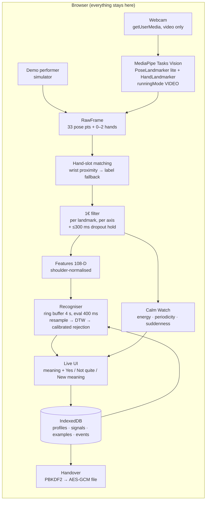

# Isyarat — Architecture

## Data flow

Camera frames exist only inside the `<video>` element and MediaPipe's call. Result objects are copied into plain numbers immediately and never retained.

## Modules

| Path | Responsibility |
|---|---|
| `src/engine/types.ts`, `constants.ts` | Data types and every tuned constant |
| `src/engine/handMatching.ts` | Assign detected hands to the subject's left/right slot |
| `src/engine/oneEuro.ts` | 1€ filter (Casiez, Roussel, Vogel 2012) |
| `src/engine/processor.ts` | Per-stream chain: matching → hold → smoothing → features |
| `src/engine/features.ts` | 108-D body-normalised feature vector |
| `src/engine/resample.ts` | Time normalisation to 16 frames |
| `src/engine/dtw.ts` | Banded DTW with weighted frame distance |
| `src/engine/calibration.ts`, `classifier.ts` | Class score, LOO thresholds, eviction, classification |
| `src/engine/recognizer.ts` | Streaming state machine (two-consecutive rule, cooldown, re-arm) |
| `src/engine/motion.ts` | Motion energy, best sub-window |
| `src/engine/calmWatch.ts` | Movement-pattern indicator with hysteresis |
| `src/engine/coach.ts` | Distinctiveness advice after teaching |
| `src/engine/simulator/` | Synthetic performer (skeleton, hands, gestures, renderer) |
| `src/engine/crypto.ts`, `handover.ts` | Encrypted `.isyarat` file format |
| `src/engine/sign/` | Sign packs (Labs): pack schema/files, registry, static handshape classifier, held/busy windows, per-component practice feedback, confusables, authoring quality checks, benchmark metrics, simulator demo pack. See `docs/SIGN_PACKS.md` |
| `src/vision/` | Camera, MediaPipe loader (shared, idempotent), inference loop, `CameraSource`/`DemoSource`, `videoFile.ts` (benchmark clips through the same pipeline) |
| `src/store/` | IndexedDB repo (`idb`, schema v2 adds `signPacks` and `signProgress`), data/session/settings/sign-pack stores (Zustand) |
| `src/ui/` | Pages, components, hooks, theme |

## Key algorithms

**Features (D = 108).** Pose subset `[0,7,8,11,12,13,14,15,16,23,24]`, (x, y) only. Coordinates are aspect-corrected (y in width units). Per frame: origin = shoulder midpoint, rotate by −atan2(shoulder vector), scale by shoulder width (≥ 0.05) → 22 numbers. Each hand: 21 points relative to its wrist, scaled by wrist→middle-MCP length, rotated into the same roll frame → 42 numbers per slot. Two presence flags. A frame is valid only if both shoulders have visibility ≥ 0.5; points with visibility < 0.3 are zeroed. *Limitation:* handles distance and roll, not large camera yaw.

**1€ filter.** `α(c, dt) = 1 / (1 + 1/(2πc) / dt)`; `dx̂ = lerp(dx̂ₚ, dx, α(d_c))`; `c = c_min + β|dx̂|`; `x̂ = lerp(x̂ₚ, x, α(c))`. Tested: stationary noise reduced ≥ 50%; a step reaches 90% within 5 frames at 15 fps.

**Frame distance and DTW.** `d(u,v) = sqrt(Σ_pose Δ² + 0.35·Σ_hand Δ² + 0.5·Σ_presence Δ²)`. Pose points absent (0,0) in either frame are skipped; hand shape is compared only when the hand is present in both (presence term still counts). Sakoe–Chiba band 3, normalised by n = 16. Pre-allocated cost matrix.

**Classification.** Class score = mean of the two smallest DTW distances. τ_c (≥ 3 examples) = mean + 2·std of leave-one-out class scores, clamped to [TAU_MIN, TAU_MAX]; else TAU_DEFAULT. Accept if `score ≤ τ_c·sensitivity`. Confidence `= 1 / (1 + (score / (τ_c·s))³)`. Margin `= (s₂ − s₁)/s₂`; below 0.08 → "low-margin" only when the two classes differ in urgency or category. Motion gate: window energy < IDLE_ENERGY → "low-motion".

**Recogniser.** 4 s ring buffer, evaluate every 400 ms over `windowMs` (default 2 s). Emit when the same signal wins two consecutive evaluations with confidence ≥ 0.55. Per-signal cooldown 3 s, then re-arm only after stillness or after a different signal is emitted. Time is injected, so tests are deterministic.

**Motion energy.** Mean keypoint speed (shoulder widths/s): positions averaged ±70 ms, displacement over a 200 ms lag (frame-to-frame differences are dominated by jitter; a 300 ms lag aliased 3 Hz flapping).

**Calm Watch.** Per 1 s bin: energy E (nose, shoulders, elbows, wrists; scale-normalised, not origin-normalised, so whole-body sway counts). Periodicity P over 8 s of shoulder-midpoint x and nose y, resampled to 15 Hz, detrended (3 s moving mean), max normalised autocorrelation at lags 0.33–3 s (0 when E < IDLE_ENERGY). Baseline: median/MAD of calm-period E (prior 0.25/0.10 until 10 samples; learns every bin for 90 s, then every 5th bin, only while calm). `z = (E − median)/(1.4826·MAD)`; `S = clamp((E − E₋₅ₛ)/(E₋₅ₛ + 0.1), 0, 3)/3`; `score = 0.5·σ(z − 2) + 0.3·P + 0.2·S`. Tiers calm < 0.35 ≤ rising < 0.65 ≤ high; enter after ≥ 3 s above, leave after 8 s below (threshold − 0.05). Not a diagnosis.

**Handover.** PBKDF2-SHA-256, 310 000 iterations, 16-byte salt → 512 bits: first 256 = AES-GCM key, second 256 → SHA-256 → 16-byte key-check value (lets the importer distinguish a wrong passphrase from a corrupted file). AES-GCM-256, 12-byte IV. Payload validated with zod; import is all-or-nothing into a new profile.

## Constants and tuning

| Constant | Value | How it was set |
|---|---|---|
| `D`, `CLIP_N`, `DTW_BAND` | 108, 16, 3 | Spec |
| `W_HAND`, `W_PRESENCE` | 0.35, 0.5 | Spec |
| `ONE_EURO` | minCutoff 1.0, β 8, dCutoff 1.0 | Spec defaults; minCutoff lowered 1.2 → 1.0 to meet the ≤ 0.5σ stationary test |
| `TAU_MIN`, `TAU_DEFAULT`, `TAU_MAX` | 1.3, 2.2, 4.0 | Synthetic benchmark: LOO τ on 5 low-noise examples under-estimates generalisation; 1.3 floor keeps 100% rejection of untaught movements |
| `IDLE_ENERGY` | 0.22 | Synthetic: idle/rock p50 ≈ 0.2, one-hand table tap 0.3–0.5 |
| `MARGIN_MIN` | 0.08 | Spec |
| `EMIT_CONFIDENCE`, `EVAL_INTERVAL_MS`, `COOLDOWN_MS` | 0.55, 400, 3000 | Spec |
| Calm tiers | 0.35 / 0.65, enter 3 s, leave 8 s, hysteresis 0.05 | Spec; unit tests: still → calm, 1 Hz rocking → rising < 15 s, flailing → high < 10 s, one-off gesture → no change |

**Synthetic benchmark — not a clinical or real-child result:** 6 taught gestures, noise 0.006–0.012, speed ±20%, amplitude ±15%, 2% dropout; 20 fresh clips each. 95.8% closed-set (5 examples), 95.0% (3 examples), 100% of untaught flap/rock/idle rejected, ≈4.5 ms per window against 6 × 10 examples. Known confusion: arms-up → cover-ears. See `docs/benchmark-synthetic.json`.

## Future work

- Few-shot temporal alignment models (TRX, Perrett et al. CVPR 2021; OTAM) or skeleton GCNs (PYSKL: ST-GCN, CTR-GCN) once consented real-world data exists — DTW was chosen because it needs no training and runs in < 1 ms per pair.
- 3-D world landmarks for camera-yaw robustness (global skeletal alignment, cf. HAA4D).
- Evaluation of the repetitive-movement detector on licensed annotated video (e.g. SSBD) — described only as repetitive-movement detection, never as meltdown prediction.
