# UI screenshots

Original EasyUI pages are shown alongside their Tanda implementation. Screenshots use local seeded test profiles, not real children.

| Component | Original EasyUI | Restyled Tanda |
| --- | --- | --- |
| stat-card | 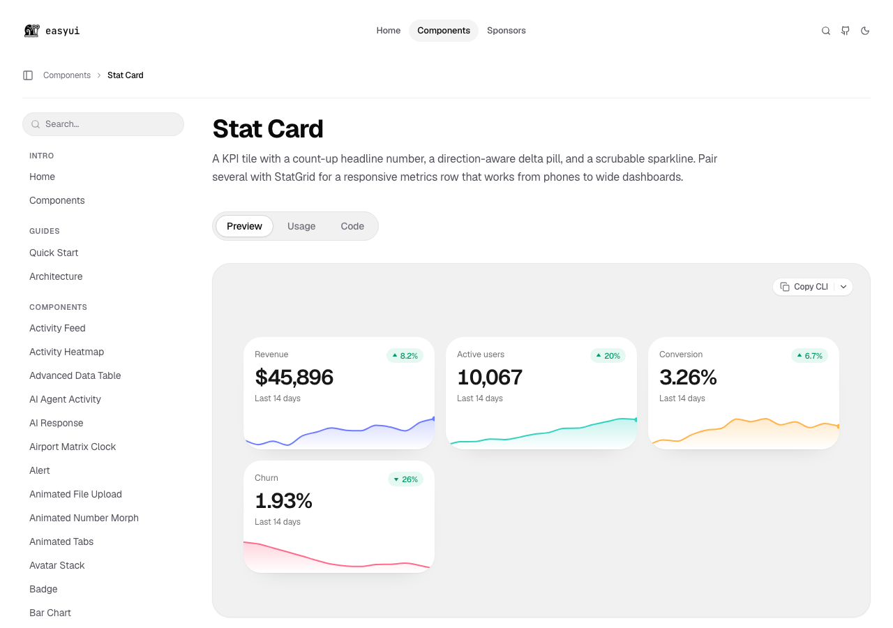 | 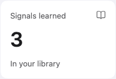 |
| live-line-chart | 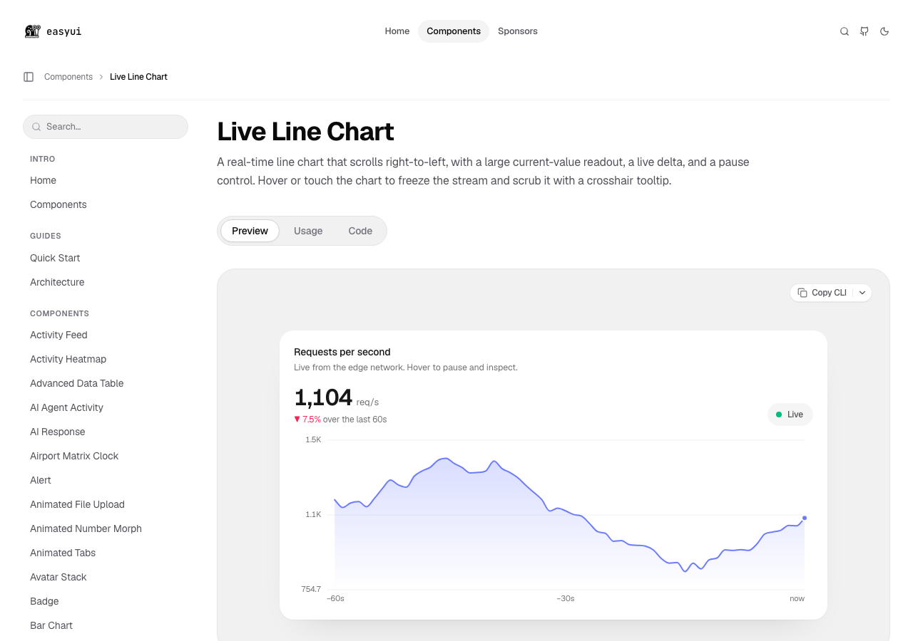 | 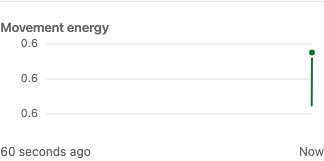 |
| activity-heatmap | 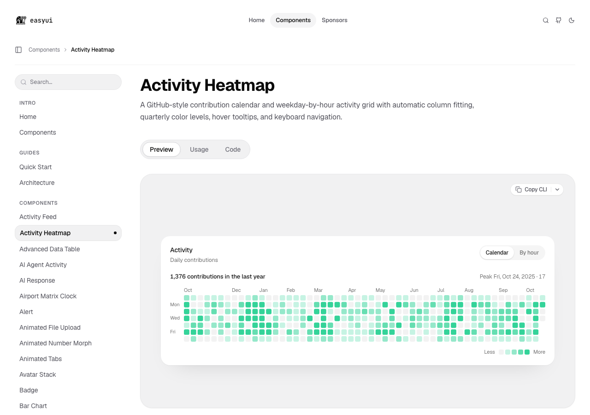 | 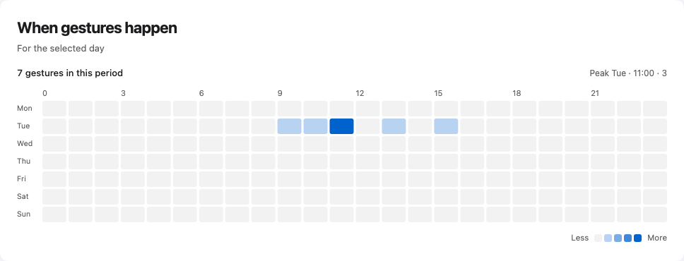 |
| bar-chart | 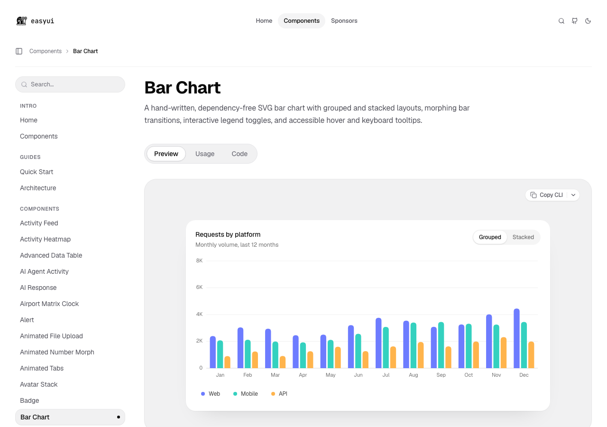 | 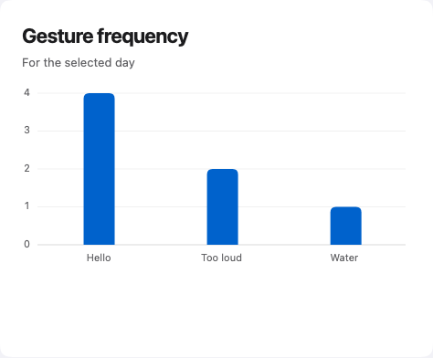 |
| donut-chart | 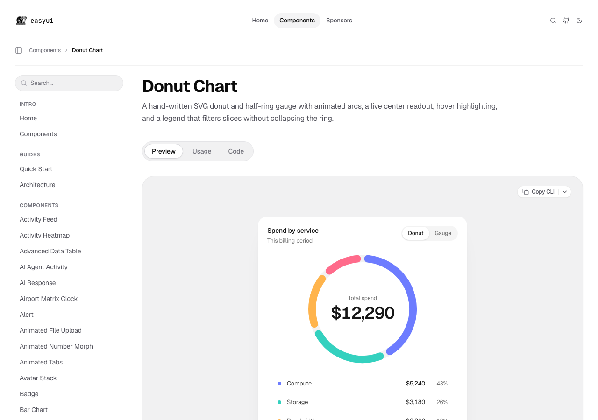 | 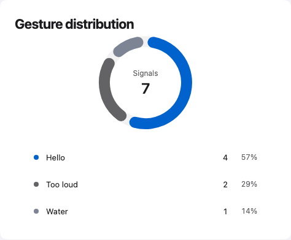 |
| data-table | 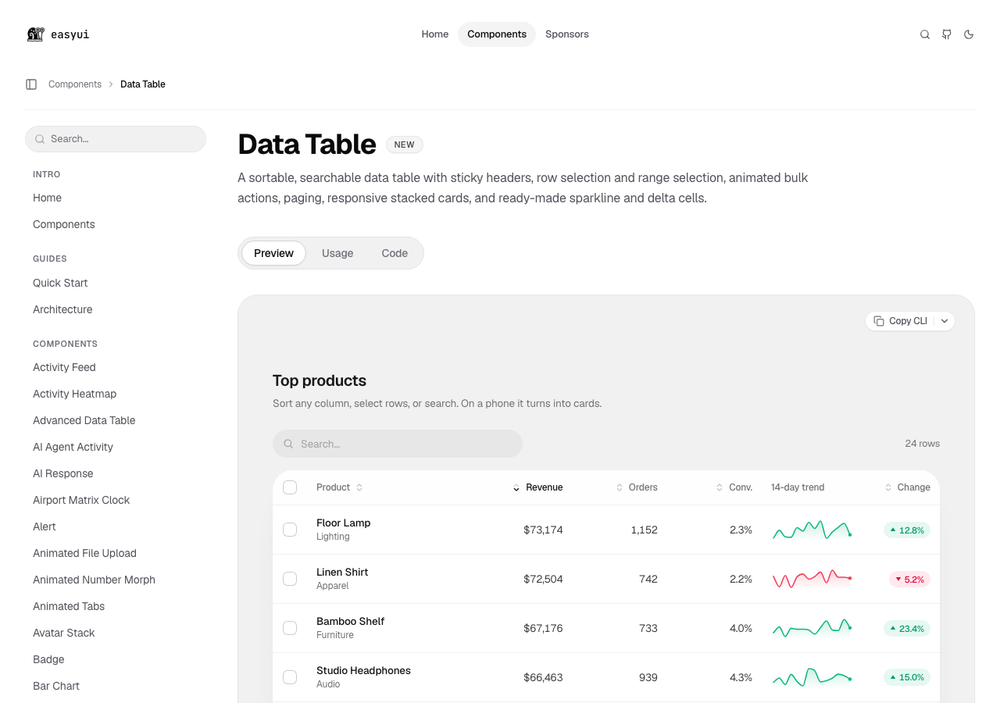 | 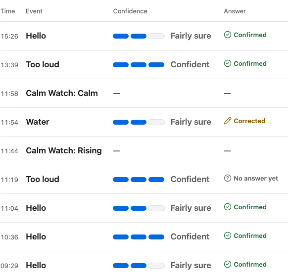 |
| pill-navigation | 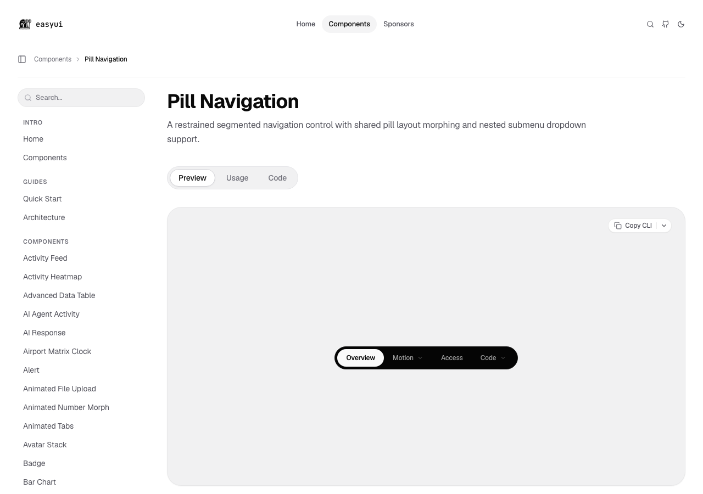 | 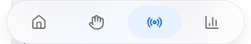 |
| sheet | 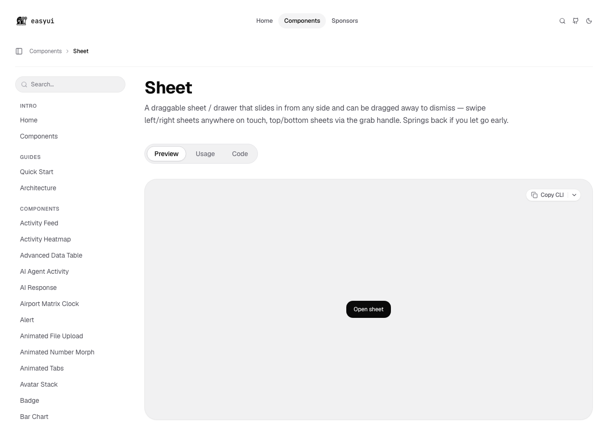 | 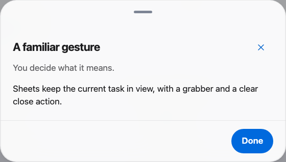 |
| undo-toast | 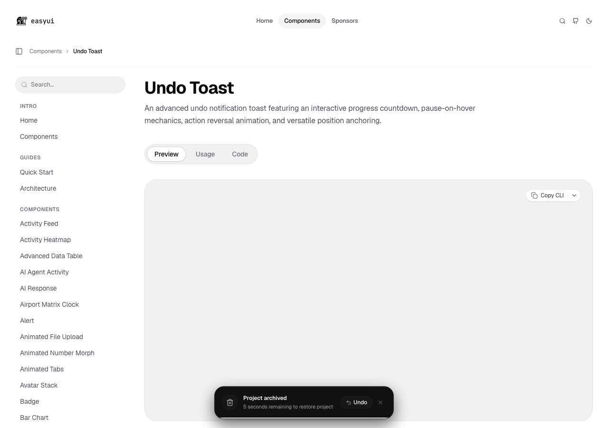 | 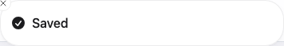 |
| press-button | 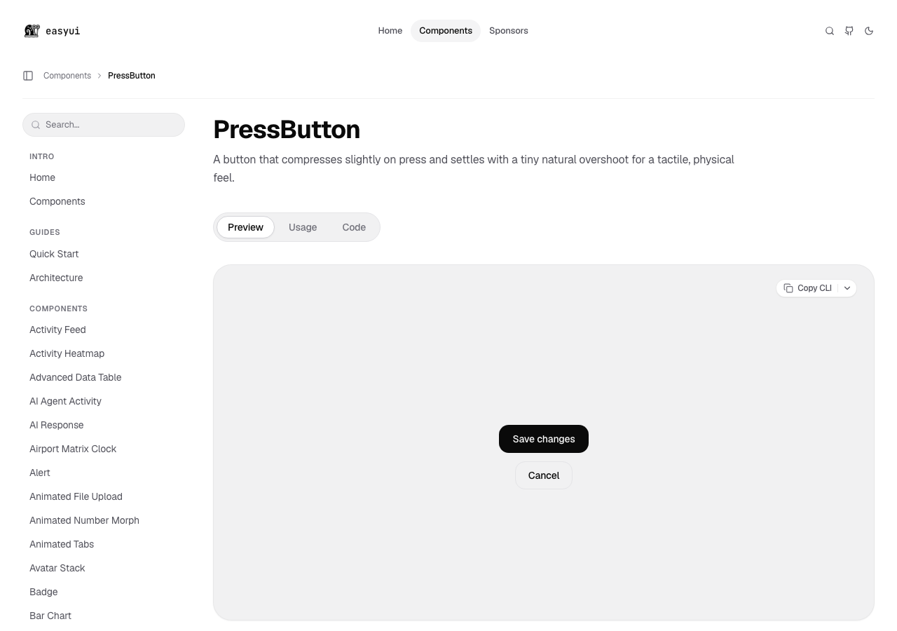 | 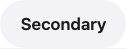 |

## Screens

- home: [light phone](home-light-390.png), [dark phone](home-dim-390.png), [light desktop](home-light-1280.png), [dark desktop](home-dim-1280.png).
- live: [light phone](live-light-390.png), [dark phone](live-dim-390.png), [light desktop](live-light-1280.png), [dark desktop](live-dim-1280.png).
- teach: [light phone](teach-light-390.png), [dark phone](teach-dim-390.png), [light desktop](teach-light-1280.png), [dark desktop](teach-dim-1280.png).
- timeline: [light phone](timeline-light-390.png), [dark phone](timeline-dim-390.png), [light desktop](timeline-light-1280.png), [dark desktop](timeline-dim-1280.png).
- settings: [light phone](settings-light-390.png), [dark phone](settings-dim-390.png), [light desktop](settings-light-1280.png), [dark desktop](settings-dim-1280.png).
- styleguide: [light phone](styleguide-light-390.png), [dark phone](styleguide-dim-390.png), [light desktop](styleguide-light-1280.png), [dark desktop](styleguide-dim-1280.png).

[First-pass screenshots](before/) preserve the original local app for comparison.

## Colorion refinement

- Floating glass dock: [light](component-pill-navigation-light.png), [dark](component-pill-navigation-dim.png).
- Checkbox export fan: [light](export-fan-light.png), [dark](export-fan-dim.png).
- Updated Insights: [phone](timeline-light-390.png), [desktop](timeline-light-1280.png).

## Tanda splash

[Full-resolution splash preview, 1179 × 2556](tanda-splash-1179x2556.png). Open the local `/#/splash` route to see the entrance animation.
